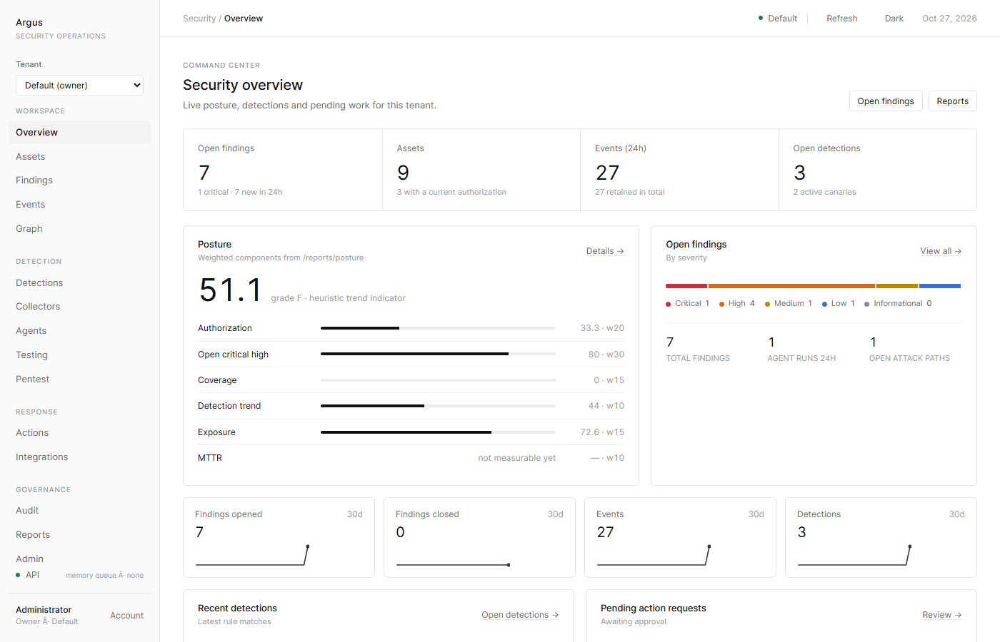

# Argus

**The open-source security operations platform where AI agents do the legwork and you stay in control.**

[](https://github.com/thomasunise/argus/actions/workflows/test.yml)
[](LICENSE)

Argus watches your cloud, identity, code, endpoints, network and Kubernetes. It catches
attacks at machine speed, investigates them with AI agents, and contains them in seconds.
Every action is typed, checked against policy, dry-run first and reversible. It is
self-hosted, multi-tenant and MIT licensed, so your security data never leaves your hands.



## Why Argus

**Stop attacks while they are happening, not the next morning.** Autonomous response
playbooks act the moment a detection fires: block an attacker at Cloudflare, cut a laptop off
the network through CrowdStrike or SentinelOne, and more from a catalog of 27 typed actions.
They start in shadow mode so you can see what they would do, use only reversible actions,
stay within hourly and blast-radius caps, and roll themselves back unless you keep the change.

**Approve from Slack in one click.** Approve, deny or roll back actions straight from the
alert. No console, no context switch.

**AI that investigates without taking the wheel.** Seven specialist agents triage, investigate
and hunt using read-only tools. They can propose a fix but never execute one. Everything they
read is treated as untrusted data, so a prompt injection hidden in a log becomes a signal
instead of a hijack.

**See every AI tool your company is really using.** The AI gateway puts OpenAI and Anthropic
traffic behind org-held keys, model allowlists, data-loss prevention, prompt-injection flags
and budgets. Shadow-AI discovery finds the services people use without approval, using your
network, cloud and SSO telemetry.

**Catch rogue AI agents in the act.** Plant canaries built for agents: hidden prompt
injections, agent rules files, a fake MCP server and fake LLM API keys. Any agent that takes
the bait trips a detection, with its IP, model and prompt recorded.

**Prove your detections work before an attacker tests them.** The agentic attack simulator
replays 8 AI-driven attack scenarios in an isolated sandbox tenant, with optional evasion
variants, and reports exactly which ones you caught, which you missed and which rules were off.

**Pentest continuously, not once a year.** Autopilot has the red-team agent plan tests, runs
them through the scope-checked harness, and re-plans from what it finds. It only runs inside
scopes a human has marked for unattended testing.

**Fix what attackers are exploiting right now.** Every finding with a CVE is enriched with
CISA's Known Exploited Vulnerabilities list and EPSS exploit-probability scores, and severity
is raised automatically. It works offline for air-gapped installs.

**Never lose a day of data.** Encrypted backups run on a schedule and land on disk, S3 or Azure. Restore is one
command, and it proves itself: row counts and every tenant's audit chain are checked before you switch over.
Per-tenant retention keeps the database lean without touching the audit trail.

**Audit-ready from day one.** A hash-linked, signed audit chain records every action, approval
and agent step, mirrored to S3 Object Lock or Azure immutable storage. Control mappings for
SOC 2, NIST 800-171 and ISO 27001 are included.

**Runs anywhere you do.** Docker Compose for a pilot, Helm for Kubernetes, and Terraform for
AWS and Azure. Every autonomous feature ships off by default, so you turn on exactly as much
autonomy as you trust.

## Tested on every push

More than 460 automated tests run on every commit against both SQLite and PostgreSQL,
alongside Bandit and pip-audit security scans, a container build and smoke test, a full
Compose stack smoke test, and Terraform and Helm validation. `docs/GO-LIVE.md` walks you
through a production rollout: start in monitoring mode, tune detections to your estate, then
switch on actions and autonomy when you are ready.

## Architecture

```
  Browser / SDK / sensors
          |
          v  HTTPS (Caddy, ALB, Front Door or your ingress)
  +-------------------------------------------------------------+
  |  API  (FastAPI)  auth: session / OIDC+PKCE / TOTP / API keys |
  |  RBAC (viewer < analyst < operator < admin < owner), CSRF,   |
  |  per-principal rate limits, request ids, security headers    |
  +------+------------------+------------------+----------------+
         |                  |                  |
   PostgreSQL           Redis queue        Audit chain
   (tenant_id on       (leases, retries,   (hash-linked per tenant,
    every table)        python -m          HMAC, JSONL / S3 Object
                        app.worker)        Lock / Azure immutable)
         |                  |
  +------+------------------+----------------------------------+
  |  Worker processes run the same handlers as the API:        |
  |   collectors.run   detections.run / baselines              |
  |   graph.recompute  testing.run   agents.run                |
  |   autoresponse.evaluate   testing.autopilot                |
  |   simulation.run   intel.enrich / refresh   ai.discover    |
  +------------------------------------------------------------+
         |
         v  agents call propose_action only -> ActionRequest(pending)
  Action broker (separate policy, approvals, dry run, rollback, kill switch)
```

Trust boundaries, in one sentence each (details in `docs/THREAT-MODEL.md`):

1. Agents cannot execute anything; their one write-capable tool creates a pending request.
   Autonomous response acts only through the broker, as the system principal, with reversible
   non-critical actions, caps and automatic rollback.
2. Everything an agent reads is wrapped as untrusted data and the prompt says so.
3. Active testing runs only inside a recorded authorization and scope, re-checked at run time.
4. Every domain table carries `tenant_id`; queries go through a scoped helper; tests assert it.
5. The audit chain is hash-linked, HMAC-signed (required in production), and mirrored to an external, optionally WORM, sink.

## What is in this checkout

| Area | Status | Where |
|---|---|---|
| App factory, settings, DB, RBAC, auth (local, OIDC, TOTP, API keys), CSRF, rate limits | implemented, tested | `app/core/`, `app/api/auth.py`, `app/api/deps.py` |
| Audit chain with JSONL / S3 Object Lock / Azure immutable blob sinks | implemented | `app/core/audit.py` |
| Job queue (in-memory and Redis, leases, retries, cancellation, reaper) and standalone worker | implemented | `app/core/queue.py`, `app/worker.py` |
| Prometheus metrics, JSON logging, optional OpenTelemetry tracing | implemented | `app/core/telemetry.py` |
| Evidence graph: nodes, edges, attack paths, exposure scoring | implemented | `app/graph/`, `app/api/graph.py` |
| Detections: 13 rules (swarm x4, identity x2, cloud, k8s, code, canary, anomaly, agentic, unsanctioned AI service), baselines, canaries (12 kinds, 4 aimed at AI agents: planted prompt injection, agent rules file, fake MCP server, fake LLM key) | implemented | `app/detections/`, `app/api/detections.py`, `app/api/canaries.py` |
| Collectors: AWS, Azure, GCP, Kubernetes, GitHub, Okta, Entra, osquery, netflow | implemented; cloud SDKs optional | `app/collectors/`, `app/api/collectors.py` |
| Test harness: scope policy, rate limits, adapters for web baseline, trivy, nuclei, zap, prowler, caldera, semgrep, gitleaks | implemented; runs the tools installed on your workers | `app/testing/`, `app/api/tests.py`, `app/api/scans.py` |
| Agent runtime, providers (Anthropic, OpenAI, Ollama, none), read-only tools, 7 specialists, eval suites | implemented | `app/agents/`, `app/api/agents.py`, `app/api/evals.py` |
| Action broker: catalog of 27 typed actions (AWS, Azure, GCP, Kubernetes, GitHub, Okta, Entra, Cloudflare, CrowdStrike, SentinelOne, Argus-internal), policy, approvals, dry run, execute, rollback, kill switch | implemented | `app/actions/`, `app/api/actions.py` |
| Autonomous response: playbooks that act on detections without a human (shadow mode first, reversible actions only, caps, automatic rollback); Slack approve / deny / roll back buttons | implemented; off by default | `app/actions/autoresponse.py`, `app/api/autoresponse.py`, `app/api/slack.py`, `docs/AUTONOMOUS-RESPONSE.md` |
| AI gateway (governed OpenAI / Anthropic proxy: org-held keys, model allowlists, DLP, prompt-injection flags, budgets, usage log) and shadow-AI discovery from network, cloud and SSO telemetry | implemented; gateway off by default | `app/ai/`, `app/api/ai_gateway.py`, `app/api/ai_inventory.py`, `docs/AI-GATEWAY.md` |
| Autonomous pentesting: the red-team planner's plans are run through the scope-checked harness and re-planned from results | implemented; off by default, opt-in per tenant and per scope | `app/testing/autopilot.py`, `app/api/autopilot.py`, `docs/AUTOPENTEST.md` |
| Threat intel: automatic CISA KEV and EPSS enrichment of findings, offline cache | implemented | `app/intel/`, `app/api/intel.py`, `docs/INTEL.md` |
| Agentic attack simulator: 8 agent-driven attack scenarios replayed in an isolated sandbox tenant, coverage report, evasion variants | implemented | `app/simulator/`, `app/api/simulations.py`, `docs/SIMULATOR.md` |
| Integrations: 13 inbound parsers behind `POST /api/v1/ingest/{source}`, 6 outbound channels (webhook, Slack, Jira, ServiceNow, PagerDuty, email) with deliveries and retries, Wazuh indexer pull | implemented | `app/integrations/`, `app/api/ingest.py`, `app/api/integrations.py` |
| Backups and retention: scheduled encrypted backups to disk, S3 and Azure, verified one-command restore, per-tenant retention policies | implemented | `app/ops/`, `app/api/backups.py`, `app/api/retention.py`, `docs/BACKUP.md` |
| Admin, assets, findings, events, investigations, approvals, audit, reports routers | implemented | `app/api/` |
| Alembic migrations (5 revisions, through backup history) and `scripts/migrate.py` | implemented | `alembic/`, `docs/MIGRATIONS.md` |
| Containers, compose, Helm, Terraform (AWS, Azure), CI, observability, docs | implemented | `Dockerfile`, `compose*.yaml`, `infra/`, `.github/`, `docs/` |

Routers are discovered automatically. The full v1 surface is in `docs/API.md`.

## Quick start (development, SQLite, no Docker)

Requirements: Python 3.11 or 3.12.

```bash
python -m venv .venv && . .venv/bin/activate        # Windows: .venv\Scripts\activate
pip install -r requirements.txt -r requirements-dev.txt
cp .env.example .env
python scripts/generate_secrets.py --write          # fills the three REPLACE_ values, plus AUDIT_SIGNING_KEY and DATA_ENCRYPTION_KEY when they are empty
uvicorn app.main:app --host 127.0.0.1 --port 8080
```

Open http://127.0.0.1:8080 and sign in as `ADMIN_EMAIL` / `ADMIN_PASSWORD` from `.env`.
With `REDIS_URL` empty, jobs run inside the API process (`WORKERS_INPROCESS=true`). With
`DB_AUTO_CREATE=true` (the default) tables are created at startup; for Alembic-managed
schemas set it to `false` and run `python scripts/migrate.py` (see `docs/MIGRATIONS.md`).

Synthetic demo data in an isolated tenant (never touches the network):

```bash
python scripts/seed_demo.py
```

It prints a `demo` tenant login and creates DEMO-labelled assets, authorizations, events that
trip `cloud.public_exposure_change` and `swarm.machine_speed_sequence`, findings, a canary and
an agent run record. Refuses to run when `APP_ENV=production`.

Tests:

```bash
python -m pytest -q
```

## Pilot (Docker Compose: API, worker, PostgreSQL, Redis)

```bash
cp .env.example .env && python scripts/generate_secrets.py --write
docker compose up --build -d
docker compose logs -f api
```

`compose.yaml` binds the API to `127.0.0.1:8080` only, runs the API and worker from one image
with a read-only root filesystem, no capabilities and no Docker socket, mounts `./targets`
read-only, and applies the schema at API start (`RUN_MIGRATIONS=true`). Add
`--profile observability` for an OpenTelemetry collector, Prometheus (scraping `/metrics`) and
Grafana with the dashboard in `infra/grafana/argus.json`.

TLS termination for a single host:

```bash
# .env: APP_ENV=production COOKIE_SECURE=true BASE_URL=https://host ARGUS_DOMAIN=host ACME_EMAIL=ops@example.com
docker compose -f compose.yaml -f compose.prod.yaml up -d
```

## Production

Kubernetes: `infra/helm/argus` (API + worker deployments, HPA, PDB, default-deny
NetworkPolicy, ingress with TLS, optional ServiceMonitor). AWS: `infra/terraform` (ECS
Fargate, RDS, ElastiCache, S3 Object Lock audit bucket, Secrets Manager, ALB + WAF).
Azure: `infra/terraform-azure` (Container Apps, Flexible Postgres, Azure Cache, immutable
blob container, Key Vault, Front Door + WAF).

The production checklist is in `docs/DEPLOYMENT.md`. The short version, enforced partly by
`assert_safe_config()` at startup:

- `APP_ENV=production` refuses to start without PostgreSQL, `REDIS_URL`, `COOKIE_SECURE=true`,
  an `https://` `BASE_URL`, `DATA_ENCRYPTION_KEY(S)`, `AUDIT_SIGNING_KEY(S)`, an external audit
  sink, and either OIDC or `TOTP_REQUIRED=true`.
- Dedicated workers (`WORKERS_INPROCESS=false`, `python -m app.worker`).
- Use an object-lock audit sink (S3 Object Lock or Azure immutable blob), not only JSONL.
- `/metrics` blocked at the edge; egress filtering for workers; secrets in a secret manager.
- Images pinned by digest and verified with cosign (`.github/workflows/release.yml`).

## Roles

Roles are cumulative (`app/core/rbac.py`):

| Role | Adds |
|---|---|
| viewer | read everything in the tenant, including autoresponse playbooks and the AI inventory |
| analyst | edit findings and detections, run agents and evals, manage canaries, record approvals, use the AI gateway |
| operator | manage and authorize assets, run tests, scans, autopilot and collectors, request, approve, execute and roll back actions, run detections and simulations |
| admin | users, API keys, settings, collector and integration configuration, the actions kill switch, test scopes (including marking one autonomous), autoresponse playbooks, AI gateway policy |
| owner | tenant settings, approving critical actions; owners of the bootstrap tenant also manage backups |

API keys carry a role and optional scopes (for example `ingest`) that further restrict them.
A `system` principal is used only inside queue handlers.

## How agents, testing and actions are governed

**Agents** (`app/agents/runtime.py`). A specialist is an `AgentSpec` with a system prompt, a
list of tool names, an output schema and budgets (`AGENT_MAX_STEPS`, `AGENT_MAX_TOKENS`,
`AGENT_MAX_SECONDS`, `AGENT_COST_CEILING_USD`, with `AGENT_MODEL_PRICES` for models outside
the built-in Claude price table). Tools are read-only views over Argus data;
the only `propose` tool creates a pending `ActionRequest` through the broker. Every tool
result is redacted, truncated and wrapped as `<untrusted_data source=...>`; the guardrail
prompt tells the model that instructions inside evidence are indicators of injection. Each
model and tool step is persisted (`agent_steps`) with input hash, tokens and latency. With
`AI_PROVIDER=none`, specialists run deterministic fallbacks. Prompt-injection and precision
eval suites live in `app/agents/evals/suites/`.

**Testing** (`app/testing/`). A `TestScope` lists assets, allowed tiers (passive, active,
intrusive), environments, a UTC window, a rate limit and a concurrency limit (runs beyond
`max_concurrency` wait in the queue). A run is allowed only if
the asset has a current `AssetAuthorization` whose flags permit the tier, the scope permits
it, the window is open and the target passes policy validation. `scope.check()` runs at
request time and again inside the worker; intrusive tiers are limited to staging and lab
environments. External tools run through `run_tool()` with a fixed argv, a timeout, bounded
output and a minimal environment.

**Actions** (`app/actions/`). Typed actions declare risk, reversibility and a parameter
schema, and implement `dry_run`, `execute` and `rollback`. A request (from an operator or an
agent's `propose_action`) goes through policy (`app/actions/policy.py`: kill switch, tenant
`actions_enabled`, deny-lists, maintenance window, auto-approval only for low-risk reversible
actions when `ACTIONS_AUTO_APPROVE_LOW`), approvals (approver differs from requester; high risk
needs two when `ACTIONS_REQUIRE_TWO_FOR_HIGH`; critical additionally needs a principal with
`actions:approve_critical`), a dry run with blast radius, execution as the `actions.execute`
queue job with a stored rollback payload, and an audit entry at every transition.
`ACTIONS_KILL_SWITCH=true` (global, environment) or `POST /api/v1/actions/kill-switch`
(per tenant, sets `actions_enabled=false`) rejects every request and execution.

**Autonomy** (`docs/AUTONOMOUS-RESPONSE.md`, `docs/AUTOPENTEST.md`). Both autonomous features
need a global switch and a tenant opt-in, and both are off by default. Autonomous response
playbooks start in shadow mode (they record what they would have done), may only use
reversible, non-critical actions, are capped per hour and by blast radius, roll actions back
automatically unless a human keeps them, and ignore detections from the simulator. Autopilot
runs only in scopes a human has marked `autonomous`; the red-team agent plans, and every test
it proposes is re-checked by the normal scope machinery before and during execution.
`AUTOPENTEST_KILL_SWITCH` and the actions kill switch stop each one at once.

## Documentation

| Document | Content |
|---|---|
| `docs/ARCHITECTURE.md` | design: packages, interfaces, data model, API table |
| `docs/API.md` | v1 route summary with status |
| `docs/DEPLOYMENT.md` | dev, compose, Kubernetes, AWS, Azure; production checklist |
| `docs/AUTONOMOUS-RESPONSE.md` | autonomous response playbooks, safety limits, Slack buttons |
| `docs/AUTOPENTEST.md` | autonomous pentesting gates and how runs proceed |
| `docs/AI-GATEWAY.md` | AI gateway policy, DLP, budgets and shadow-AI discovery |
| `docs/SIMULATOR.md` | agentic attack simulator scenarios and coverage reports |
| `docs/INTEL.md` | CISA KEV and EPSS enrichment, caching and offline mode |
| `docs/BACKUP.md` | backups, restore procedure and drill, data retention policies |
| `docs/MIGRATIONS.md` | Alembic workflow |
| `docs/GO-LIVE.md` | step-by-step production rollout in monitoring-only mode |
| `docs/SECURITY.md` | security model as implemented, reporting |
| `docs/THREAT-MODEL.md` | STRIDE per trust boundary, prompt injection, SSRF, tenancy, credentials, broker abuse, supply chain |
| `docs/RUNBOOKS.md` | incident procedures |
| `docs/COMPLIANCE.md` | SOC 2 / NIST 800-171 / ISO 27001 control mapping and the evidence Argus produces for each control |
| `docs/ROADMAP.md` | implemented versus next |
| `CONTRIBUTING.md` | contributing guide |

## Security

Please report vulnerabilities privately through GitHub's private vulnerability reporting
(Security tab), not in public issues. Details in `docs/SECURITY.md`.

## License

MIT for this repository. Third-party tools (nuclei, ZAP, Prowler, CALDERA, Semgrep, Gitleaks,
Trivy), cloud SDKs and model providers are governed by their own licenses and terms.
